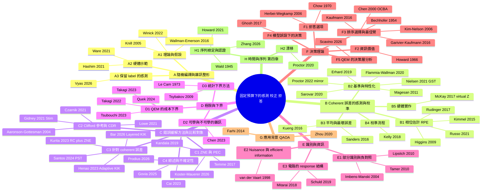

# 文獻庫內容筆記

**用途：** 快速知道每篇在講什麼、屬於哪條研究脈絡、和第三章有什麼關係。書目資料（作者、期刊、卷期、DOI）與查證狀態以 [`library.csv`](library.csv) 為準；這份筆記只寫內容。

**狀態：** 2026-11-20 建立，共 63 篇；2026-11-23 增補 5 篇，現共 68 篇。筆記多數是摘要層級或前作筆記的整理，**不是全文精讀**。每篇最後一行標明筆記依據，引用到論文前請先回頭讀原文。

## 怎麼新增或修改（請先讀）

1. 在 `library.csv` 加一列：填 `key`、`theme`（下方脈絡代碼）、書目欄位與查證狀態。
2. 在本檔對應脈絡的小節底下，複製下面的範本，標題用同一個 `key`。
3. 若新增了脈絡或子脈絡，同步更新「心智圖」與「脈絡代碼表」。
4. 執行 `python tools/check_library.py`，確認 CSV 與本檔的 key 一一對應。

範本：

```markdown
#### `key` — 作者 年份，短題目
- **一句話：**
- **內容重點：**
- **和本專案：**
- **限制／注意：**
- *依據：全文／原文段落／摘要／背景知識／僅書目；記錄者與日期*
```

依據的意思：**全文**＝讀過相關章節；**原文段落**＝只讀了特定段落；**摘要**＝只讀摘要或官方紀錄；**背景知識**＝領域常識，這次沒有重讀；**僅書目**＝只核對了書目資料。若是 AI 代理人讀的，要註明，等你確認。

## 心智圖

GitHub 會直接把下面的 Mermaid 區塊畫成心智圖。



## 各脈絡在第三章的位置

| 代碼 | 脈絡 | 回答第三章的哪個問題 | 對應關卡 |
|---|---|---|---|
| A | 隨機編譯與雜訊整形 | RC 在什麼假設下有效；保留 label 能不能感測 ε | Gate 1A |
| B | Coherent 誤差的感測與校準 | 已知參考的探針能不能估出 ε；P-amp 與既有方法差在哪 | Gate 1B、校正動作 |
| C | 錯誤緩解方法與比較對象 | 有哪些比較對象（P2、CDR、KIK）；新穎性邊界 | 比較對象、Gate 2 |
| D | 極限與下界 | 「任何探針都選不出來」要怎麼證明；和既有 QEM 下界的差別 | 理論骨架 |
| E | 識別與資訊 | I1／I2／I3 怎麼定義；可檢驗與可估計的差別 | Gate 1A 判準 |
| F | 決策理論 | 三動作規則、拒答代價、感測值不值得 | Gate 3、Gate 4 |
| G | 應用背景 | QAOA 的定義與參數結構 | 背景 |
| H | 時間與序列 | 何時重新感測、漂移 | 第四章 |

### 脈絡代碼表

A1 理論與假設｜A2 硬體示範｜A3 保留 label 的感測｜B1 相位估計｜B2 基準與特性化｜B3 平均與最壞誤差｜B4 校準流程｜B5 硬體實作｜C1 ZNE 與 PEC｜C2 Clifford 參考與 CDR｜C3 針對 coherent 誤差｜C4 綜述與不確定性｜D1 QEM 成本下界｜D2 可學性｜D3 統計下界方法｜E1 部分識別與負對照｜E2 Nuisance 與 efficient information｜E3 電路 response 結構｜F1 拒答｜F2 資訊價值｜F3 排序選擇與最佳臂｜F4 模型誤設｜F5 QEM 決策層｜G1 QAOA｜H1 序列檢定｜H2 漂移

---

## A 隨機編譯與雜訊整形

### A1 理論與假設

#### `wallman2016` — Wallman & Emerson 2016，Randomized compiling
- **一句話：** 提出 randomized compiling（RC）：在 hard gate 兩側插入隨機 Pauli 並併入 easy gate，把一般 Markovian 誤差平均成隨機 Pauli 通道。
- **內容重點：** 電路分成 easy／hard 輪；精確結果要求 easy gate 的誤差與閘無關，hard gate 的誤差可以任意依賴閘；easy gate 誤差有閘相依時改用距離上界處理。
- **和本專案：** 角度相依的 E2 落在 easy gate 一側，違反精確定理的假設；這是 Gate 1A 的出發點。
- **限制／注意：** 結果是對「所有隨機版本的平均通道」而言，不談保留 label 的條件資料。
- *依據：全文（AI 代理人，2026-11-20，待你確認）；細節見 `rc_assumption_table.md`*

#### `winick2022` — Winick et al. 2022，RC 的抑制機制與條件
- **一句話：** 把 RC 的效果拆成「單次隨機化的類解耦效應」與「多次平均的雜訊整形效應」。
- **內容重點：** 把整形結果推廣到時間相依的 Markovian 雜訊與部分非 Markovian 情形；給出閘相依、非 Markovian 雜訊下 coherent 累積可能保留的失效機制。
- **和本專案：** 提醒「單一個帶 label 的電路」不是 Pauli 通道；不能把 RC 當成對 E2 必然有效。
- **限制／注意：** 證明未獨立重現。
- *依據：全文（AI 代理人，2026-11-20，待你確認）*

#### `knill2005` — Knill 2005，以雜訊裝置做量子計算
- **一句話：** 提出後選擇式容錯架構，其中使用 Pauli frame 隨機化。
- **內容重點：** Pauli frame 隨機化的早期出處。
- **和本專案：** 只作為 Pauli 隨機化概念的歷史出處。
- **限制／注意：** 不處理 label 感測。
- *依據：背景知識（前作筆記，未讀摘要）*

### A2 硬體示範

#### `hashim2021` — Hashim et al. 2021，超導處理器上的 RC
- **一句話：** 在超導處理器上示範 RC 把 coherent 誤差轉成隨機雜訊，並提升演算法表現。
- **內容重點：** 硬體證據顯示 RC 改變 coherent 誤差的行為。
- **和本專案：** RC 在硬體上「有效」的證據；但它是緩解用途，不是感測。
- **限制／注意：** 平均通道層級的結果。
- *依據：摘要（前作筆記）*

#### `ware2021pfr` — Ware et al. 2021，超導量子位元上的 Pauli frame 隨機化
- **一句話：** 用 gate set tomography 顯示：不隨機化時誤差是 coherent 的，隨機化後變成接近 Pauli 的隨機誤差，並壓低非 Markovian 特徵。
- **內容重點：** 隨機化後的 Pauli 模型違反程度降到統計上不顯著；保真度沒有變差。
- **和本專案：** 直接說明平均通道「丟掉了什麼」：coherent 資訊被平均掉，這正是 Vyas 主張保留 label 的理由。
- **限制／注意：** 單一量子位元；平均通道。
- *依據：摘要（Claude，2026-11-20）*

### A3 保留 label 的感測

#### `vyas2026` — Vyas 2026，從 RC label 恢復 coherent 誤差
- **一句話：** 主張 RC 平均掉的 coherent 資訊並沒有消失，只要保留每次的 twirl label，就能從 label 與結果的相關性估計 coherent 誤差，不需要額外電路。
- **內容重點：** Fisher 守恆恆等式：條件資訊 = 邊際資訊 + label 帶來的資訊；單量子位元例子中誤差的正負號隨 label 翻轉；硬體上以人為注入的 virtual 相位做正控制。
- **和本專案：** 最接近 Gate 1A 的前作。依對照，它的 sθ 誤差對應本專案的加法相位 φ，不是乘法誤差 ε。
- **限制／注意：** 估計需要 visibility v；在 QAOA 目標電路中，v 的角色由未知的 response 斜率扮演，不可部署。
- *依據：全文（AI 代理人，2026-11-20，待你確認）＋摘要頁（Claude）；細節見 `notes/vyas_2026.md`*

## B Coherent 誤差的感測與校準

### B1 相位估計 RPE

#### `higgins2009` — Higgins et al. 2009，非適應式 Heisenberg 極限相位估計
- **一句話：** 推導並實驗示範一種不需要適應式量測、就能在 Heisenberg 極限下無歧義估計相位的干涉方案。
- **內容重點：** 用多次施加相位的階梯取代糾纏態。
- **和本專案：** RPE 的基礎，也是 P-amp 重複階梯的源頭。
- **限制／注意：** 光學實驗。
- *依據：摘要（Claude，2026-11-20）*

#### `kimmel2015rpe` — Kimmel, Low & Yoder 2015，Robust phase estimation 校準
- **一句話：** 提出 robust phase estimation（RPE），可穩健且有效率地估計單量子位元閘的振幅誤差與 off-resonance 誤差，達到 Heisenberg scaling。
- **內容重點：** 以 Higgins 等人的程序為基礎做穩健化；能容忍量測機率中的加性誤差。
- **和本專案：** 振幅誤差就是乘法角度誤差（ε 的單量子位元版本）。**P-amp 本質上屬於 RPE 這一類**，不能主張感測器新穎。
- **限制／注意：** 有 2021 年勘誤，arXiv v3 指向 Russo et al. 2021 的修正分析；都未讀。
- *依據：摘要（Claude，2026-11-20）；見 `notes/phase_estimation_pamp_boundary.md`*

#### `rudinger2017rpe` — Rudinger et al. 2017，RPE 實驗示範
- **一句話：** 在離子阱量子位元上實作 RPE，估計旋轉相位。
- **內容重點：** 不假設完美的態準備與量測、不需輔助量子位元；呈現 Heisenberg scaling；與 GST 交叉驗證。
- **和本專案：** RPE 在硬體上可行的證據。
- **限制／注意：** 單量子位元，沒有決策層。
- *依據：摘要（Claude，2026-11-20）*

#### `russo2021rpe` — Russo et al. 2021，RPE 的一致性檢查
- **一句話：** 擴充 RPE，能辨識出落在預期統計範圍外的錯誤結果。
- **內容重點：** RPE 的穩健性取決於雜訊是否滿足門檻假設；一致性檢查可找出從哪一步開始估計不再可信。
- **和本專案：** 等於「感測器層級的拒答規則」；可能成為 P-amp 的負控制或拒答依據（須在第 4 週凍結前決定）。
- **限制／注意：** DOI 未核對。
- *依據：摘要（Claude，2026-11-20）*

### B2 基準與特性化

#### `magesan2011` — Magesan, Gambetta & Emerson 2011，可擴展 RB
- **一句話：** 提出可擴展的 randomized benchmarking，估計平均錯誤率。
- **內容重點：** 把複雜雜訊壓縮成平均衰減參數。
- **和本專案：** 平均錯誤率看不到 coherent 角度誤差，是「平均指標的盲點」的例子。
- **限制／注意：** 不識別 ε。
- *依據：摘要（前作筆記）*

#### `erhard2019` — Erhard et al. 2019，Cycle benchmarking
- **一句話：** 提出 cycle benchmarking，量測多量子位元 cycle 的錯誤率。
- **內容重點：** 在 10 量子位元離子阱上示範。
- **和本專案：** Vyas 估計器需要的 visibility 可能由它提供；其成本必須計入預算。
- **限制／注意：** 給的是 Pauli 保真度，不是角度誤差。
- *依據：摘要（前作筆記）*

#### `flammia2020pauli` — Flammia & Wallman 2020，有效估計 Pauli 通道
- **一句話：** 以少量量測有效估計 Pauli 通道。
- **內容重點：** RC 之後的平均通道可以學到什麼、要多少樣本。
- **和本專案：** 對照「平均通道可學的資訊」與「label 條件資料的資訊」。
- **限制／注意：** 只處理 Pauli 通道。
- *依據：背景知識（前作筆記，未讀摘要）*

#### `nielsen2021gst` — Nielsen et al. 2021，Gate set tomography
- **一句話：** GST 的完整理論，包含 gauge 自由與 gauge 固定。
- **內容重點：** 不假設完美的準備與量測，完整重建閘組。
- **和本專案：** 感測光譜的「完整特性化」一端；gauge 自由是「原理上看不到」的標準例子，也關係到 ε 是否有明確定義。
- **限制／注意：** 成本高。
- *依據：摘要（前作筆記）*

#### `proctor2022mirror` — Proctor et al. 2022，Mirror circuit 基準
- **一句話：** 以隨機 mirror circuit 做可擴展基準，估計多量子位元層錯誤並偵測 crosstalk。
- **內容重點：** 正反電路相消的設計。
- **和本專案：** 與 P-amp 的 echo 構造相近，可作新穎性對照。
- **限制／注意：** 量平均層錯誤，不估角度誤差。
- *依據：摘要（前作筆記）*

#### `sarovar2020` — Sarovar et al. 2020，偵測 crosstalk
- **一句話：** 給 crosstalk 嚴格的操作定義，並用觀測機率的條件相依性偵測與定位。
- **內容重點：** 偵測 crosstalk 是否存在。
- **和本專案：** P-amp 的失效模式之一：重複的區塊和目標電路中的誤差因 crosstalk 而不同。
- **限制／注意：** 偵測存在與否，不估偏差大小。
- *依據：摘要（前作筆記）*

### B3 平均與最壞誤差

#### `kueng2016` — Kueng et al. 2016，比較實驗與容錯門檻
- **一句話：** coherent 誤差讓基準測得的平均錯誤與容錯所需的最壞錯誤差距最大（約平方根關係）。
- **內容重點：** 平均保真度低估 coherent 誤差的危害。
- **和本專案：** 說明為什麼 E2 這類 coherent 誤差對決策特別危險。
- **限制／注意：** 通道層級指標，不是決策損失。
- *依據：摘要（前作筆記）*

#### `sanders2016` — Sanders, Wallman & Sanders 2016，由平均保真度界定錯誤率
- **一句話：** 從回報的平均閘保真度推出錯誤率上界，並證明一般雜訊下漸近緊。
- **內容重點：** 平均保真度約束不了最壞情況。
- **和本專案：** 同上。
- **限制／注意：** 同上。
- *依據：摘要（前作筆記）*

### B4 校準流程

#### `kelly2018dag` — Kelly et al. 2018，以有向無環圖做量子位元校準
- **一句話：** 把校準實驗之間的依賴關係表示成有向圖，校準變成可自動化的圖走訪問題。
- **內容重點：** 校準是一連串有成本、有依賴的實驗。
- **和本專案：** 「校正」動作在實務上的成本與結構參考。
- **限制／注意：** 僅 arXiv，期刊發表未確認。
- *依據：摘要（Claude，2026-11-20）*

### B5 硬體實作

#### `mckay2017vz` — McKay et al. 2017，Virtual Z 閘
- **一句話：** 在超導量子位元上，用之後驅動脈衝的相位偏移實作零時長的 virtual Z 閘；搭配兩個 Xπ/2 可組成任意單量子位元閘。
- **內容重點：** 該實作把 virtual Z 寫成控制 frame 的相位更新，不增加額外脈衝時間；論文也討論用相位更新修正部分脈衝誤差。
- **和本專案：** 說明抽象 `RZ` 不一定對應一個會直接承受角度過旋的實體脈衝。因此，E2 的硬體載體不能只從電路層 `RZ` 名稱推定，必須另行核對編譯、原生閘與控制實作。
- **限制／注意：** 摘要支持零時長的 phase-frame 實作，但不證明整個控制堆疊無誤差，也不證明現行 IBM 硬體上的所有 `RZ` 都具有相同實作。脈衝振幅或原生雙量子位元閘只是待驗證的可能載體。
- *依據：摘要（Claude，2026-11-20）*

#### `krantz2019` — Krantz et al. 2019，超導量子位元工程指南
- **一句話：** 超導量子位元的工程綜述：元件、閘、讀出、雜訊與校準。
- **內容重點：** 包含 virtual Z、雙量子位元交互作用與殘餘 ZZ 耦合等概念。
- **和本專案：** HW-P1 偵測到的零注入偏移與共同相位偏移，「可能」來自原生相干相位（CZ 或 ZZ）；本文只把它列為假說的背景。
- **限制／注意：** 綜述文章，不描述 HW-P1 使用的 IBM backend。
- *依據：僅書目＋摘要（搜尋結果；Claude，2026-11-23，待你確認）*

## C 錯誤緩解方法與比較對象

### C1 ZNE 與 PEC

#### `temme2017` — Temme, Bravyi & Gambetta 2017，短深度電路的錯誤緩解
- **一句話：** 提出 zero-noise extrapolation（ZNE）與 probabilistic error cancellation（PEC）。
- **內容重點：** 外插到零雜訊；以準機率抵銷雜訊。
- **和本專案：** 第一章的方法來源；第三章的背景。
- **限制／注意：** 估計器層級。
- *依據：背景知識（前作）*

#### `kandala2019` — Kandala et al. 2019，錯誤緩解擴展計算能力
- **一句話：** 在超導硬體上示範 ZNE。
- **內容重點：** 硬體上的 ZNE 證據。
- **和本專案：** 背景。
- **限制／注意：** —
- *依據：背景知識（前作）*

#### `koster2026` — Köster & Mauerer 2026，錯誤緩解評比的人為改善
- **一句話：** 指出 ZNE 評比中可能出現的人為（假性）改善。
- **內容重點：** 評估方法本身會製造改善的假象。
- **和本專案：** 支持以決策而非估計誤差評估的立場。
- **限制／注意：** 預印本。
- *依據：前作筆記*

### C2 Clifford 參考與 CDR

#### `czarnik2021` — Czarnik et al. 2021，Clifford data regression
- **一句話：** 用接近 Clifford、可古典模擬的訓練電路，學習有雜訊值到理想值的對應（CDR）。
- **內容重點：** 訓練電路的理想值可算，再迴歸校正目標。
- **和本專案：** 前作 P2（Clifford twin）的方法來源；P2 是第三章的必要比較對象。
- **限制／注意：** 失效條件是訓練電路對雜訊的反應不能代表目標；使用迴歸，第三章不實作。
- *依據：前作筆記*

#### `lowe2021` — Lowe et al. 2021，資料驅動錯誤緩解的統一框架
- **一句話：** 提出 variable-noise CDR，把 ZNE 與 CDR 結合在同一框架。
- **內容重點：** 資料驅動 QEM 的統一觀點。
- **和本專案：** CDR 鄰域的定位。
- **限制／注意：** 內容未為本專案細讀。
- *依據：摘要（前作筆記）*

#### `aaronson2004` — Aaronson & Gottesman 2004，改良的 stabilizer 電路模擬
- **一句話：** stabilizer 電路的有效古典模擬演算法（CHP）。
- **內容重點：** Clifford 電路可在多項式時間模擬。
- **和本專案：** P2 的 twin 理想值，以及把 P2 當 ε 一階估計器時所需導數的計算依據。
- **限制／注意：** 只引演算法。
- *依據：背景知識（前作筆記）*

#### `gidney2021stim` — Gidney 2021，Stim
- **一句話：** 快速 stabilizer 電路模擬器。
- **內容重點：** 工具。
- **和本專案：** twin 參考值的第二套實作，用於交叉驗證。
- **限制／注意：** 工具引用。
- *依據：背景知識（前作筆記）*

### C3 針對 coherent 誤差

#### `santos2024pst` — Santos, Bar & Uzdin 2024，Pseudo twirling
- **一句話：** 一種處理 coherent 誤差的 twirling 變體（依計畫描述）。
- **內容重點：** 待讀：需要哪些可控的驅動正負號、哪些過旋／欠旋不被抑制。
- **和本專案：** 可能是 Pauli label 以外的另一條感測或緩解途徑；比較對象。
- **限制／注意：** 只核對過摘要；作者全名與完整題目待查。
- *依據：摘要（計畫原始狀態）*

#### `henao2023akik` — Henao, Santos & Uzdin 2023，Adaptive KIK
- **一句話：** 自適應的 KIK 錯誤緩解（依計畫描述）。
- **內容重點：** 待讀：「自適應」的意思、雜訊強度訊號、如何與 RC 整合。
- **和本專案：** 新穎性邊界：自適應的緩解係數不等於逐例的動作選擇。
- **限制／注意：** 只核對過摘要。
- *依據：摘要（計畫原始狀態）*

#### `bar2026lkik` — Bar, Santos & Uzdin 2026，Layered KIK
- **一句話：** KIK 的分層版本（依計畫描述）。
- **內容重點：** 待讀：動態電路的貢獻、反閘的實作、資源成本。
- **和本專案：** P-amp 新穎性的邊界之一。
- **限制／注意：** 只核對過摘要。
- *依據：摘要（計畫原始狀態）*

#### `kurita2023` — Kurita et al. 2023，RC 與 ZNE 合用
- **一句話：** 在估計器層級結合 RC 與 ZNE（依計畫描述）。
- **內容重點：** 待讀：coherent 雜訊模型、VQE 設定、ZNE 成本。
- **和本專案：** 防止把「RC 加錯誤緩解」當成新穎貢獻；第三章的貢獻必須在決策層。
- **限制／注意：** 只核對過摘要。
- *依據：摘要（計畫原始狀態）*

### C4 綜述與不確定性

#### `cai2023` — Cai et al. 2023，量子錯誤緩解綜述（RMP）
- **一句話：** QEM 的完整綜述。
- **內容重點：** 方法分類與比較。
- **和本專案：** 定位用。
- **限制／注意：** 綜述。
- *依據：背景知識（前作）*

#### `prodius2026` — Prodius et al. 2026，QEM 的不確定性下穩健設計
- **一句話：** 用抽樣 QEM 輸出量化有限 shot 的不確定性，並最佳化 ZNE 與 CDR 的超參數、shot 配置與穩健性。
- **內容重點：** QEM 不確定性的量化與最佳化。
- **和本專案：** 它最佳化估計器；第三章在執行時選動作。
- **限制／注意：** 設計層級。
- *依據：摘要（前作筆記）*

#### `govia2025` — Govia et al. 2025，錯誤模型不準造成的系統誤差上界
- **一句話：** 利用既有的 error-learning 資料，替錯誤模型不準確造成的 QEM 系統誤差建立上界，並在 IBM 硬體與模擬上評估。
- **內容重點：** model-violation 型的保證。
- **和本專案：** 最接近「偏差感知決策」的 QEM 工作之一；它界定誤差，不選動作。
- **限制／注意：** 界定最壞觀測量誤差，不是候選差距。
- *依據：摘要與相關段落（前作筆記）*

## D 極限與下界

### D1 QEM 的成本下界

#### `takagi2022` — Takagi et al. 2022，錯誤緩解的基本極限
- **一句話：** 以抽樣 overhead 界定錯誤緩解能降低多少誤差。
- **內容重點：** 局部去極化的分層電路中，一般協議的 overhead 隨深度指數成長；局部 dephasing 下 PEC 在一大類策略中最佳。
- **和本專案：** 估計器層級的下界；第三章的下界是動作層級，是不同的量。
- **限制／注意：** 估計器層級。
- *依據：摘要（前作筆記）*

#### `takagi2023` — Takagi et al. 2023，錯誤緩解的普遍抽樣下界
- **一句話：** 對一般錯誤緩解協議（含非線性後處理）給出普遍的抽樣下界。
- **內容重點：** 一大類協議的抽樣成本隨深度指數成長。
- **和本專案：** 同上。
- **限制／注意：** 同上。
- *依據：摘要（前作筆記）*

#### `tsubouchi2023` — Tsubouchi, Sagawa & Yoshioka 2023，以量子估計理論界定成本
- **一句話：** 用虛擬電路的量子 Fisher 資訊矩陣，界定無偏 QEM 的量測成本。
- **內容重點：** 分層電路在一大類 Markovian 雜訊下成本隨深度指數成長。
- **和本專案：** 和第三章的 Fisher information 語言最接近的 QEM 下界。
- **限制／注意：** 估計器層級。
- *依據：摘要（前作筆記）*

#### `quek2024` — Quek et al. 2024，更緊的錯誤緩解極限
- **一句話：** 把錯誤緩解當成統計推論，指出最壞情況下即使淺層電路也可能需要超多項式數量的樣本。
- **內容重點：** 雜訊造成的 scrambling 出現得比先前認為的更早。
- **和本專案：** 同上。
- **限制／注意：** 同上。
- *依據：摘要（前作筆記）*

### D2 可學與不可學的雜訊

#### `chen2023learnability` — Chen et al. 2023，Pauli 雜訊的可學性
- **一句話：** 證明 Clifford 閘上 Pauli 雜訊的可學部分對應某個圖的 cycle space，cut space 的部分完全學不到。
- **內容重點：** 有些雜訊分量原則上不可學。
- **和本專案：** 「原則上看不到」的物理範本；第三章的 frame-covariance 是同類型的結構性盲點。
- **限制／注意：** 定理條件不一定適用非 Clifford 的 QAOA 電路。
- *依據：摘要（前作筆記）*

### D3 統計下界方法

#### `lecam1973` — Le Cam 1973，維度限制下估計量的收斂
- **一句話：** Le Cam 兩點法與可分辨性方法的早期來源。
- **內容重點：** 兩個分布難以區分時，任何決策都有錯誤下界。
- **和本專案：** 動作選擇 blindness lemma 與有限 pilot 下界的出發點。
- **限制／注意：** 頁碼層級的核對沿用前作。
- *依據：背景知識（前作筆記）*

#### `tsybakov2009` — Tsybakov 2009，非參數估計導論
- **一句話：** 非參數估計的教科書，第 2 章詳細處理 minimax 下界。
- **內容重點：** Le Cam 兩點法等下界技術的標準寫法。
- **和本專案：** 寫有限 pilot 下界時的標準引用。
- **限制／注意：** 2026-11-23 已核對原書掃描：Lemma 2.3 是 Le Cam inequalities，Lemma 2.6 是本文使用的 Bretagnolle–Huber/KL 下界；證明仍以專案內自足推導為準。
- *依據：僅書目＋出版社頁面的章節描述（Claude，2026-11-20）*

#### `efron1979` — Efron 1979，Bootstrap
- **一句話：** 提出 bootstrap，並把 jackknife 解釋為它的線性近似。
- **內容重點：** 以重抽樣近似統計量的抽樣分布。
- **和本專案：** Gate 3 的 cluster bootstrap 下界與 HW-P1 的 block bootstrap 區間都源自此法。
- **限制／注意：** 本專案用的 cluster／block 版本是後續標準延伸，不是此文內容。
- *依據：僅書目＋摘要（搜尋結果；Claude，2026-11-23，待你確認）*

#### `bretagnolle1979` — Bretagnolle & Huber 1979，密度估計的 minimax 風險
- **一句話：** 通常被認為是 Bretagnolle–Huber 不等式（1 − TV ≥ ½ e^{−KL}）的出處。
- **內容重點：** 密度估計的 minimax 下界。
- **和本專案：** 有限 pilot 下界（T2）使用此不等式；證明在專案內自足。
- **限制／注意：** 1978 年另有 Séminaire de probabilités XII 版本；不等式在原文的確切位置未核對。
- *依據：僅書目＋摘要（搜尋結果；Claude，2026-11-23，待你確認）*

## E 識別與資訊

### E1 部分識別與負對照

#### `imbens2004` — Imbens & Manski 2004，部分識別參數的信賴區間
- **一句話：** 參數寫成 θ = f(P, A)，P 是可觀測分布，A 只知道屬於某集合；識別區域是所有可能 A 對應的 θ。
- **內容重點：** 提出覆蓋真值（而非整個區域）的信賴區間。
- **和本專案：** 第二章「原則上盲」定義的來源，第三章沿用。
- **限制／注意：** 量子雜訊的代入是專案自己的推導。
- *依據：原文段落（前作筆記）*

#### `tamer2010` — Tamer 2010，計量經濟學中的部分識別
- **一句話：** 部分識別的綜述：點識別問能否唯一還原，部分識別問能學到什麼。
- **內容重點：** 識別集合；與含擾動參數的估計問題相連。
- **和本專案：** 識別集合的語言。
- **限制／注意：** 原文沒有本專案的 (θ, F) 聯合未知寫法。
- *依據：原文段落（前作筆記）*

#### `lipsitch2010` — Lipsitch et al. 2010，負對照
- **一句話：** 用負對照偵測觀察性研究中的混淆與偏差。
- **內容重點：** 負對照與目標共享未觀測的共同原因時，負對照上的關聯揭露混淆。
- **和本專案：** matched null、label 置換對照的設計範本（只是類比）。
- **限制／注意：** 流行病學來源，套到量子探針是類比。
- *依據：原文段落（前作筆記）*

### E2 Nuisance 與 efficient information

#### `vandervaart1998` — van der Vaart 1998，Asymptotic Statistics
- **一句話：** 漸近統計教科書；半參數模型一章定義 efficient score 與 efficient information。
- **內容重點：** 有 nuisance 參數時，目標參數的資訊是把它的 score 投影到 nuisance score 的正交補空間後的資訊。
- **和本專案：** Gate 1A 判準中 I3 的正式定義依據。
- **限制／注意：** 引用時要核對頁碼。
- *依據：僅書目＋出版社章節頁（Claude，2026-11-20）*

### E3 電路的 response 結構

#### `mitarai2018` — Mitarai et al. 2018，Quantum circuit learning
- **一句話：** 提出 quantum circuit learning，其中包含以參數平移求解析梯度的做法。
- **內容重點：** 期望值對每個旋轉角是低階三角函數。
- **和本專案：** 只用它的結構事實：理想 response 屬於已知的三角多項式類，因此 I3 是有限維的秩問題。
- **限制／注意：** 論文是機器學習脈絡，第三章不用 ML。
- *依據：全文掃描（Codex，2026-11-23）；書目資料另由 DOI／出版社頁面核對*

#### `schuld2019` — Schuld et al. 2019，在量子硬體上計算解析梯度
- **一句話：** 把 parameter shift rule 推廣到生成元最多只有兩個特徵值的任何閘。
- **內容重點：** 梯度可以用同一套硬體、平移參數後的電路求得。
- **和本專案：** 同上的結構事實；也支持 frame-covariance 草稿中「縮放封閉條件不成立」的修正。
- **限制／注意：** 只用結構事實。
- *依據：摘要（Claude，2026-11-20）*

#### `rothenberg1971` — Rothenberg 1971，參數模型的識別
- **一句話：** 參數模型局部與全域識別的經典理論。
- **內容重點：** 在正則條件下，局部識別與資訊矩陣非奇異相關。
- **和本專案：** 對照本專案「資訊為零 ≠ 不可識別」的區分；本專案以明確的觀測等價構造證明不可識別，不依賴資訊矩陣。
- **限制／注意：** 正則條件與本專案的 nuisance 類別不同。
- *依據：僅書目＋摘要（搜尋結果；Claude，2026-11-23，待你確認）*

## F 決策理論

### F1 拒答選項

#### `chow1970` — Chow 1970，最佳辨識錯誤與拒答的取捨
- **一句話：** 給出最佳拒答規則，以及錯誤率與拒答率之間的一般關係。
- **內容重點：** 錯誤率可以由拒答函數直接算出。
- **和本專案：** 三動作規則拿掉「校正」後，應退化成 Chow 型的門檻規則（Part 1 的檢查）。
- **限制／注意：** 沒有校正動作；假設後驗機率已知。
- *依據：摘要（Claude，2026-11-20）*

#### `herbei2006` — Herbei & Wegkamp 2006，有拒答選項的分類
- **一句話：** 研究允許拒答的二元分類，拒答用在兩類條件機率接近、難以分類的觀測。
- **內容重點：** 做錯代價 1、拒答代價 d；推廣 plug-in 規則與經驗風險最小化的理論。
- **和本專案：** 和 λ_A 損失形式相同；「兩類接近就拒答」對應「候選差距落在不確定範圍內就拒答」。
- **限制／注意：** 分類問題；論文中的學習方法不採用。
- *依據：摘要（Claude，2026-11-20）*

### F2 資訊價值

#### `howard1966voi` — Howard 1966，資訊價值理論
- **一句話：** 從影響決策的機率與經濟因素一起考慮，定義資訊的價值。
- **內容重點：** 資訊只有在可能改變決策時才有價值。
- **和本專案：** Gate 3 的理論祖先：感測值不值得，看它能否改變動作、降低的期望損失是否超過成本。
- **限制／注意：** 頁碼有兩種說法（22–26 或 22–34），DOI 未確認。
- *依據：摘要（Claude，2026-11-20）*

### F3 排序選擇與最佳臂

#### `bechhofer1954` — Bechhofer 1954，常態平均數的排序單樣本程序
- **一句話：** ranking and selection 的原始出處。
- **內容重點：** 選出平均最大的母體。
- **和本專案：** top-1 決策框架的源頭。
- **限制／注意：** 沒有拒答或校正。
- *依據：前作筆記*

#### `kimnelson2006` — Kim & Nelson 2006，選擇最佳系統
- **一句話：** ranking and selection 的綜述章節。
- **內容重點：** 固定預算或固定信心下選出最佳系統。
- **和本專案：** 固定預算選擇的語言。
- **限制／注意：** 沒有校正動作。
- *依據：背景知識（前作筆記）*

#### `chen2000ocba` — Chen et al. 2000，OCBA
- **一句話：** 在候選之間最佳分配模擬預算以提高選擇正確率。
- **內容重點：** optimal computing budget allocation。
- **和本專案：** 感測與執行之間的預算分配可借用其形式。
- **限制／注意：** 假設輸出無偏。
- *依據：背景知識（前作筆記）*

#### `garivier2016` — Garivier & Kaufmann 2016，固定信心下的最佳臂辨識
- **一句話：** 固定信心下最佳臂辨識的最優演算法與下界。
- **內容重點：** 樣本複雜度的緊下界。
- **和本專案：** 有限 pilot 下界的範本。
- **限制／注意：** 假設回饋無偏。
- *依據：背景知識（前作筆記）*

#### `kaufmann2016` — Kaufmann, Cappé & Garivier 2016，最佳臂辨識的複雜度
- **一句話：** 最佳臂辨識的複雜度下界。
- **內容重點：** 固定預算與固定信心兩種設定。
- **和本專案：** 同上。
- **限制／注意：** 同上。
- *依據：背景知識（前作筆記）*

### F4 模型誤設下的決策

#### `ghosh2017` — Ghosh et al. 2017，誤設的線性 bandit
- **一句話：** 證明在特定的模型誤設下，原本最優的線性 bandit 演算法可能遭受線性 regret，並提出先檢驗模型再選演算法的方法。
- **內容重點：** 模型誤設會破壞決策保證。
- **和本專案：** 決策理論中最接近「觀測被 E2 系統性偏移」的類比。
- **限制／注意：** 序列 regret 設定，不是固定預算，也沒有拒答。
- *依據：摘要與相關段落（前作筆記）*

### F5 QEM 的決策層分析

#### `scavino2026` — Scavino 2026，QEM 的 decision kernel
- **一句話：** 主張準確度的提升需要決策相關性才有意義；以差距為基礎的決策只取決於殘差差距的分布。
- **內容重點：** 區分 common-mode 與差異偏差；固定總 shot 預算；有目標差距的局部可辨識條件（Corollary C.1）與小型硬體壓力測試。
- **和本專案：** 目前最接近第三章的決策層 QEM 工作；凍結任何新穎性措辭前必須全文比較。前作筆記指出它沒有說明殘差偏差的估計如何取得。
- **限制／注意：** 預印本；它是否處理動作選擇需確認。
- *依據：原文段落（前作筆記）*

## G 應用背景 QAOA

#### `farhi2014` — Farhi, Goldstone & Gutmann 2014，QAOA
- **一句話：** 提出量子近似最佳化演算法（QAOA）。
- **內容重點：** cost layer 與 mixer layer 交替；參數 (γ, β)。
- **和本專案：** 第三章的決策任務（MaxCut 的 top-1 參數選擇）建立在它上面。
- **限制／注意：** —
- *依據：背景知識（前作）*

#### `zhou2020qaoa` — Zhou et al. 2020，QAOA 的表現、機制與實作
- **一句話：** 分析 QAOA 的表現、機制與在近期裝置上的實作。
- **內容重點：** 參數結構與啟發式。
- **和本專案：** 候選參數設計的背景。
- **限制／注意：** —
- *依據：背景知識（前作筆記）*

#### `preskill2018` — Preskill 2018，NISQ
- **一句話：** 提出 NISQ（noisy intermediate-scale quantum）一詞並評估其前景。
- **內容重點：** 閘雜訊限制可靠執行的電路規模。
- **和本專案：** 論文開頭的背景引用。
- **限制／注意：** 觀點文章，僅作背景。
- *依據：僅書目＋摘要（搜尋結果；Claude，2026-11-23，待你確認）*

## H 時間與序列（第四章）

### H1 序列檢定與認證

#### `wald1945` — Wald 1945，序列假設檢定
- **一句話：** 提出序列機率比檢定（SPRT）。
- **內容重點：** 資料一筆筆進來時何時停止並下結論。
- **和本專案：** 第四章「何時重新感測」的源頭。
- **限制／注意：** 第四章使用。
- *依據：前作筆記*

#### `howard2021` — Howard et al. 2021，時間一致的信賴序列
- **一句話：** 時間一致、非參數、非漸近的 confidence sequence。
- **內容重點：** 任何時刻停止都有效的信賴區間序列。
- **和本專案：** 第四章每月硬體時間序列的分析工具。
- **限制／注意：** 第四章使用。
- *依據：前作筆記*

#### `zhang2026spot` — Zhang, Seshadri & Knill 2026，序列抽查
- **一句話：** 序列式抽查（依計畫描述）。
- **內容重點：** 待讀：非 i.i.d. 模型、抽查配置、認證目標。
- **和本專案：** 第四章的橋樑；不改動第三章。
- **限制／注意：** 只看過摘要片段。
- *依據：摘要片段（計畫原始狀態）*

### H2 漂移

#### `proctor2020drift` — Proctor et al. 2020，偵測與追蹤量子處理器的漂移
- **一句話：** 提出以頻譜分析偵測與量測量子處理器中時間相依誤差的通用方法。
- **內容重點：** 可套用在任何量子處理器實驗的時間序列資料。
- **和本專案：** 第四章每月硬體時間序列的核心參考。
- **限制／注意：** 第四章使用。
- *依據：摘要（Claude，2026-11-20）*
