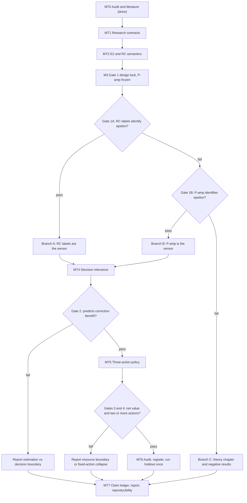

# Sense, Correct, or Abstain: Research Work Plan

**Status:** public work plan, revised 2026-11-20. Planning only: no experiment
has been run, no protocol has been independently registered, and no hardware
execution is authorized. This document describes *what* will be done, in what
order, and what each step must produce. It deliberately contains no calendar
dates or personal time budget; progress is tracked by milestone, not by date.

**How this document relates to the others**

| Document | Role |
|---|---|
| [`../research_program_plan_v0.md`](../research_program_plan_v0.md) | Scientific rationale, gate criteria, endpoints, risks. Authoritative if this work plan disagrees with it. |
| This work plan | Task hierarchy, dependencies, deliverables, completion criteria, and stop rules. |
| [`../literature/`](../literature/README.md) | Literature library, reading notes, novelty boundary. |
| [`../audits/`](../audits/predecessor_e2_audit.md) | Audit of the predecessor project's E2 implementation. |
| [`../theory/`](../theory/gate1_frame_covariance_draft.md) | Theory drafts (unreviewed until stated otherwise). |

**How to read the plan**

- Main Tasks (MT) are executed in order; Branch Tasks run only when their
  entry condition holds; Extension Tasks are outside the primary evidence.
- Each task ends with **Depends on**, **Deliverables**, and **Done when**.
  Deliverable paths marked *(planned)* do not exist yet.
- Status values: `done`, `in progress`, `not started`, `conditional` (runs only
  if a gate routes to it), `blocked` (waiting on a recorded owner decision).
- Evidence types are always labeled: analytic, noiseless simulation, noisy
  simulation, device-parameter simulation (never hardware evidence), hardware.

## Research objective

Determine whether runtime evidence from randomized-compiling labels can identify
angle-dependent coherent bias in QAOA well enough to support a deployable choice
among three actions:

1. issue the uncorrected decision;
2. recalibrate and execute again; or
3. abstain.

The study treats parameter sensing, decision relevance, and policy value as
separate scientific questions. A sensor is not considered useful merely because
it estimates a gate parameter: its output must predict a decision-relevant
effect, retain value after all sensing and correction costs are charged, and
support a genuinely non-degenerate action policy.

The project also develops task-independent theory for cases in which runtime
evidence cannot distinguish latent error states that require different actions.

---

## Task map and current status

| Task | Research Part | Gate | Status | Main deliverable |
|---|---|---|---|---|
| MT0 Preparatory audit and literature | before Part 1 | — | done (owner review of agent readings pending) | predecessor audit, literature library, RC assumption table, novelty draft |
| MT1 Research contracts | Part 1 | — | done 2026-11-20 (M1 achieved at `8dc782c`; owner-review revision with D1–D3 recorded; proofs await the owner's line-by-line check) | [decision-problem contract](../contracts/decision_problem_v1.md), [three-action theory draft](../theory/three_action_theory_v1.md) |
| MT2 Error and compilation semantics | Part 1 | — | **done (M2 committed 2026-11-20; no Gate-1 computation run)** | [E2 semantics](../theory/e2_semantics_v1.md), [RC construction](../theory/rc_construction_v1.md), [conditional likelihood](../theory/conditional_likelihood_v1.md), corrected [frame-covariance note](../theory/gate1_frame_covariance_draft.md) |
| MT3 Gate 1A identifiability | Part 1 | 1A | not started | Gate 1 math spec, design lock, Gate 1A report |
| Branch A (1A passes) | Part 1 | — | conditional | sensor freeze record |
| Branch B (1A fails: P-amp) | Part 1 | 1B | conditional (P-amp spec must be frozen in MT3) | Gate 1B report |
| Branch C (1A and 1B fail) | Part 1 → theory chapter | — | conditional | negative-identifiability and lower-bound chapter |
| MT4 Decision relevance | Part 2 | 2 | not started | Gate 2 report, locked transfer rule |
| MT5 Three-action policy | Part 3 | 3, 4 | not started | Gate 3/4 report, power analysis |
| MT6 Confirmatory study | Part 3 (freeze) and Part 4 (run) | — | not started | registered protocol, one-time holdout, recomputation |
| MT7 Synthesis | Part 4 | — | not started | claim ledger, report, reproducibility package |
| Extension 1 Drift | Chapter 4 | — | not started (design only; no hardware authorized) | longitudinal protocol draft |
| Extension 2 Limits and transfer | Chapter 5 | — | not started | transfer-task comparison |

### Dependency graph

GitHub renders the diagram below.



### Milestones

Milestones are ordered; none is attached to a date.

| ID | Milestone | Entry condition | Exit evidence |
|---|---|---|---|
| M1 | Contracts drafted | MT0 done | decision-problem contract and three-action theory draft committed |
| M2 | Semantics frozen | owner decisions D1–D3 recorded (see "Pending decisions") | E2 primary model, RC construction, and conditional likelihood committed |
| M3 | Gate 1 design lock | M2 | Gate 1A design, controls, tolerances, and the complete P-amp specification (including `N`, `f`, `epsilon_min`, estimator) committed with a content hash **before any Gate 1A computation** |
| M4 | Gate 1 decision | M3 | Gate 1A report; Gate 1B report only if Gate 1A failed by its frozen criterion |
| M5 | Gate 2 decision | Branch A or B | Gate 2 report on development data only |
| M6 | Gates 3 and 4 decision | M5 passed | Gate 3/4 report, locked fixed comparator, power analysis |
| M7 | Confirmatory protocol registered | M6 passed and pre-data audit closed | independent timestamp (OSF or equivalent) |
| M8 | Holdout read once | M7 | raw holdout artifacts, primary endpoint scored once, independent recomputation |
| M9 | Synthesis complete | M8, or an earlier stop route | claim ledger, report, reproducibility package |

---

## Main Task 0: Preparatory audit and literature (done)

Completed before Part 1 so that the plan rests on checked facts about the
predecessor project and on a mapped literature.

| Output | Location | Key result |
|---|---|---|
| Predecessor E2 audit and review | [`../audits/predecessor_e2_audit.md`](../audits/predecessor_e2_audit.md), [`../audits/predecessor_e2_audit_review.md`](../audits/predecessor_e2_audit_review.md) | In `bias-probe-visibility`, E2 is equivalent to a logical-angle error; its frames never pass through the cost `RZ`; P3 is blind to E2 and the E2 improvement came from P2. Nothing there shows that RC labels sense `epsilon`. |
| RC assumption table | [`../literature/rc_assumption_table.md`](../literature/rc_assumption_table.md) | Angle-proportional E2 sits on the easy-gate side and violates the gate-independence assumption of exact tailoring. |
| Vyas audit | [`../literature/notes/vyas_2026.md`](../literature/notes/vyas_2026.md) | The paper's sign-flipping error maps to the additive `phi`, not `epsilon`; labels may give a deployable test for `phi != 0` but not an estimate. |
| Frame-covariance draft | [`../theory/gate1_frame_covariance_draft.md`](../theory/gate1_frame_covariance_draft.md) | Draft prediction that Gate 1A fails under the compiled-angle model with virtual Z frames. Unreviewed. |
| Sensor comparison and novelty draft | [`../literature/p2_cdr_pamp_comparison.md`](../literature/p2_cdr_pamp_comparison.md), [`../literature/novelty_claim_draft.md`](../literature/novelty_claim_draft.md) | P-amp is close to robust phase estimation; novelty cannot rest on the sensor. |
| Literature library | [`../literature/library_notes.md`](../literature/library_notes.md), [`../literature/library.csv`](../literature/library.csv) | 63 entries in eight research threads, with a mind map. |

**Open items carried forward:** owner confirmation of the agent full-text
readings (Wallman & Emerson, Winick, Vyas); full-text reading of the robust
phase-estimation papers and of the closest decision-level QEM work before any
novelty wording is frozen.

---

## Main Task 1: Establish the research contracts

### Subtask 1.1: Define the decision problem

- Define the latent error state, runtime observations, action set, resource
  budget, and decision loss.
- Fix the action semantics:
  - **no action:** issue the decision produced by the original execution;
  - **correct:** estimate a correction, recalibrate, and perform the specified
    corrected execution;
  - **abstain:** withhold the decision and incur a prespecified abstention loss.
- Define the unit of analysis, including graph, candidate pair, circuit
  instance, noise condition, and repeated execution.
- Distinguish wrong-answer loss, abstention loss, correction failure, and
  resource consumption.
- Define the fixed policies used as comparators: always issue, always correct,
  and always abstain.

### Subtask 1.2: Freeze the evidence hierarchy

- **Analytic evidence:** identities, rank conditions, risk decompositions,
  blindness results, and finite-sample lower bounds.
- **Noiseless simulation:** exact semantic checks, likelihood checks, parameter
  recovery, and implementation verification.
- **Noisy simulation:** decision relevance, policy value, action frequency, and
  robustness under frozen noise models.
- **Device-parameter simulation:** simulations parameterized by a device model;
  never reported as hardware evidence.
- **Hardware-derived evidence:** permitted only under a separately specified,
  independently timestamped, and explicitly authorized addendum.

### Subtask 1.3: Define the deployability boundary

The deployable sensor and policy may use only:

- measured runtime outcomes;
- recorded randomized-compiling labels;
- circuit metadata available before execution;
- analytically known reference quantities declared computable at runtime; and
- calibration quantities whose acquisition cost is included in the resource
  ledger.

They may not use:

- the ideal target expectation or ideal target gap;
- the true injected error parameter;
- the error-structure label;
- simulator-only likelihood derivatives;
- future calibration information; or
- confirmatory outcomes during rule construction.

### Subtask 1.4: Define the single primary endpoint

For evaluation unit `u`, define a frozen loss of the form

```text
L_u = 1{an answer is issued and the selected candidate is wrong}
      + lambda_A * 1{the policy abstains}
      + lambda_F * 1{correction is attempted but execution fails}.
```

The sole primary endpoint is the paired improvement in decision value of the
deployable sensor policy relative to the development-locked best fixed policy:

```text
Delta_V = mean_u[L_fixed,u - L_policy,u].
```

All sensing, reference, calibration, correction, and re-execution shots are
charged to one fixed execution budget. Classical computation and circuit count
are reported separately.

### Subtask 1.5: Develop sensor-independent theory

- Derive a three-action risk identity for no action, correction, and
  abstention.
- Derive pairwise conditions under which sensing changes the optimal action.
- Prove an action-selection blindness lemma: two latent states can induce the
  same runtime evidence distribution while requiring different optimal actions.
- Derive a finite-pilot lower bound on the probability of selecting the wrong
  action.
- Define a value-of-information condition comparing expected action-loss
  reduction with sensing and correction cost.
- Define policy non-degeneracy and characterize honest collapse to a fixed
  action.

- **Depends on:** MT0.
- **Deliverables:** decision-problem contract [`docs/contracts/decision_problem_v1.md`](../contracts/decision_problem_v1.md) covering 1.1–1.4 (draft, unreviewed); three-action theory draft [`docs/theory/three_action_theory_v1.md`](../theory/three_action_theory_v1.md) covering 1.5 (draft, unreviewed).
- **Done when:** the loss, `lambda_A`, `lambda_F`, the correction action, the comparators, and the deployability list are written down and approved by the owner (decisions D1–D3); the three-action risk identity is proved and reduces to the predecessor's Eq. (6) when correction is removed and `lambda_A = 0`, and to a Chow-type reject rule when correction is removed and `lambda_A > 0`.
- **Status (2026-11-20):** done after the owner-review revision. D1–D3, the issue-only comparator, the deployability clarification, and the ideal-tie rule are recorded in the contract. The risk identity and both reductions are proved in draft and await the owner's line-by-line check; the Chow-form attribution and the Tsybakov lemma locations remain unverified and do not affect any proof.

---

## Main Task 2: Specify the error and compilation semantics

### Subtask 2.1: Separate three multiplicative-error models

- **Logical-angle model:** the multiplicative error acts on the logical QAOA
  angle before label absorption.
- **Compiled-angle model:** the multiplicative error scales the compiled angle
  produced by the label-absorption rule.
- **Physical-control model:** the error acts on a pulse amplitude, duration, or
  composite control parameter rather than on an abstract `RZ` instruction.

On superconducting hardware an `RZ` is commonly a virtual frame update with no
pulse of its own (see `mckay2017vz` in the literature notes), so the existence
of an angle-proportional `RZ` error cannot be assumed; its physical carrier must
be identified or the model recorded as synthetic.

Select one model as the primary existence question before sensor evaluation.
Treat the remaining models as prespecified secondary or diagnostic cases. If a
physical-control representation cannot be supported faithfully, record it as
not modeled rather than replacing it with a virtual rotation.

### Subtask 2.2: Define the randomized-compiling construction

- Specify the easy-gate set `C`, hard-gate set `G`, twirling set `T`, and every
  correction `T_k^c`.
- Verify correction closure under the frozen QAOA decomposition.
- Specify boundary-cycle handling and measurement relabeling.
- Define how every label is retained in the execution record.
- Enumerate the dressed operation and compiled angle associated with every
  allowed label.
- Verify noiseless logical equivalence for every label pattern.
- Separate the channel obtained from averaging randomized compilations from the
  conditional experiment that retains labels.

### Subtask 2.3: Audit randomized-compiling assumptions

- Determine whether angle-dependent E2 is assigned to easy-gate noise,
  hard-gate noise, or a control-level implementation.
- Check the gate-independence assumption required for exact easy-gate noise
  tailoring.
- When easy-gate dependence is present, distinguish an exact tailoring claim
  from a bound relative to a gate-independent surrogate.
- Record whether the chosen twirling group is normalized by the easy-gate
  group.
- Identify label-dependent control errors or environmental memory that could
  preserve coherent accumulation.
- Do not infer parameter identifiability from channel-level noise tailoring.

### Subtask 2.4: Construct the conditional likelihood

For candidate `k`, cost location `ell`, label `t`, and outcome `b`, derive

```text
P(b | t, epsilon, phi, nuisance).
```

The derivation must begin from the implemented dressed circuit. It must not
assume that the identity

```text
X RZ(theta) X = RZ(-theta)
```

automatically determines how a physical error transforms.

Explicitly model:

- multiplicative over-/under-rotation `epsilon`;
- additive phase `phi`;
- visibility and label-independent offset;
- label-dependent SPAM or control terms when they are in scope;
- correlations among labels at different gate locations; and
- the angle set supplied by candidates and cost layers.

- **Depends on:** MT1.
- **Deliverables:** [E2 semantics note](../theory/e2_semantics_v1.md); [RC construction note with the label-to-dressed-gate table](../theory/rc_construction_v1.md); [conditional likelihood](../theory/conditional_likelihood_v1.md); reviewed and corrected [frame-covariance note](../theory/gate1_frame_covariance_draft.md).
- **Done when:** one primary E2 model is frozen with a stated physical justification (the virtual-Z question in the RC assumption table is answered or recorded as not modeled); every label pattern is checked for noiseless logical equivalence; the likelihood is derived from the implemented dressed circuit.

---

## Main Task 3: Gate 1A - Test identifiability from RC labels

### Subtask 3.1: Separate the information sources

Report three quantities independently:

- **I1 - label-contrast information:** information supplied by differences or
  correlations across retained labels without an ideal target response.
- **I2 - oracle absolute-level information:** information available when the
  ideal target response curve is treated as known. This is a diagnostic only
  and cannot satisfy Gate 1A.
- **I3 - deployable profile information:** efficient or profile information for
  `epsilon` after unknown response, visibility, offset, and other declared
  nuisance quantities are accounted for.

Do not report full rank without identifying which of these information sources
creates the rank.

### Subtask 3.2: Derive local identifiability conditions

- Derive the Fisher information for `(epsilon, phi)` under the frozen
  conditional likelihood.
- Determine rank, smallest eigenvalue, and condition number under the frozen
  angle and label design.
- Identify score-zero points and nuisance directions.
- Determine whether independent labels identify individual parameters or only
  linear combinations.
- State the limits of local Fisher analysis under phase wrapping, boundaries,
  nonregular likelihoods, and global aliasing.

### Subtask 3.3: Derive finite-separation limits

- Construct pairs of latent error states that are difficult to distinguish
  from runtime data.
- Require the paired states to imply different optimal actions.
- Bound action-selection error using total variation, Hellinger distance, KL
  divergence, or a Le Cam two-point argument.
- Report whether the bound is meaningful under the frozen sensing budget.
- Keep physically irrelevant or overly loose pairs as failed constructions
  rather than selecting only favorable examples.

### Subtask 3.4: Define analytic controls

- `phi = 0` balanced-label control.
- single effective angle control, expected to confound `epsilon` and `phi` when
  the likelihood depends only on `epsilon * theta + phi`.
- distinct-angle design with nonzero measurement scores.
- label-shuffled control.
- matched no-error control.
- oracle-response diagnostic showing how I2 can appear full rank while I1 and
  deployable I3 remain deficient.

### Subtask 3.5: Perform the minimum noiseless study

- Use fully enumerable two-qubit circuits for analytic and implementation
  cross-checks.
- Use three-qubit circuits to introduce nontrivial candidate and circuit
  context.
- Include a single-candidate/single-angle blind control.
- Include a candidate pair with distinct frozen angles.
- Evaluate one cost layer as the primary setting.
- Include additional layers only as a prespecified extension, not as a rescue
  after a negative primary result.
- Compare analytic rank, numerical rank, and noiseless parameter recovery.
- Verify that the deployable estimator never reads I2-only quantities.

### Gate 1A decision

Gate 1A passes only if I1 together with the admissible part of I3 identifies
`(epsilon, phi)` under at least one frozen deployable design, and noiseless
recovery agrees with the analytic prediction.

Gate 1A fails if:

- admitted information about `epsilon` is zero or rank deficient in every
  frozen design;
- apparent identifiability is supplied only by I2 or another oracle quantity;
- the RC construction is not logically equivalent or does not close;
- the label does not act on the noisy quantity; or
- the required visibility or response is not deployably identifiable.

A partial outcome is recorded explicitly rather than rounded up: labels may
support a deployable **test** of `phi != 0` (its null distribution does not
depend on the unknown response) while giving no estimate of `phi` and no
information about `epsilon`. Such an outcome is a Gate 1A failure for
`epsilon`; it is reported as evidence that label data can support abstention but
not correction.

- **Depends on:** MT2.
- **Deliverables:** Gate 1 math specification *(planned: `docs/theory/gate1_math_spec_v1.md`)*; Gate 1 design lock including the complete P-amp specification *(planned: `docs/freeze/gate1_design_lock.md`)*; minimal exact simulator and tests *(planned: `src/`, `tests/`)*; Gate 1A report with I1, I2, I3 tables and a signed prediction-mismatch list *(planned: `docs/results/gate1a_report.md`)*.
- **Done when:** milestone M3 is committed before any Gate 1A computation; the report states pass or fail against the frozen criterion and names the information source behind every rank claim.

---

## Branch Task A: Gate 1A passes

- Freeze RC labels as the sole primary sensor.
- Preserve P-amp and P2 only as prespecified comparators.
- Carry the RC-label estimator and its uncertainty into the decision-relevance
  tasks.
- Restrict the scientific claim to the frozen task, circuit family, error
  semantics, angle design, and resource model.
- Do not claim that RC labels universally recover coherent errors or that RC
  universally corrects E2.

- **Depends on:** Gate 1A passed.
- **Deliverables:** sensor freeze record appended to the Gate 1A report.
- **Done when:** RC labels are recorded as the sole primary sensor, with P-amp and P2 named as comparators only.

---

## Branch Task B: Gate 1A fails - Execute the prespecified Gate 1B fallback

### Subtask B.1: Freeze P-amp before observing Gate 1A outcomes

- Define the repeated/amplified circuit block.
- Define the echo or analytically known reference.
- Freeze the repetition ladder, angle set, parameter grid, shot allocation,
  statistic, estimator, uncertainty method, and pass threshold.
- Define phase-unwrapping or no-alias conditions.
- Define negative-angle behavior and symmetry assumptions.
- Define the minimum visibility and the handling of visibility decay.
- Charge every reference and amplified circuit to the sensing budget.
- Decide (owner decision D4) between the plain least-squares statistic and the
  robust phase-estimation estimator, and whether to add RPE-style consistency
  checks; record the noise-threshold assumption of the chosen ladder as a
  prespecified failure condition.

### Subtask B.2: Test P-amp identifiability

- Derive the design matrix and Fisher information for `(epsilon, phi)`.
- Verify noiseless parameter recovery across the frozen grid.
- Test echo/reference semantics independently from target semantics.
- Detect phase ambiguity and nonmonotonic response.
- Report the sensitivity of the estimator to visibility loss and repetition
  depth.
- Reject the sensor if its power or identifiability requires shrinking the
  frozen grid after inspection.

### Subtask B.3: Compare P-amp with predecessor P2

- Implement P2 as a mandatory same-budget comparator, not as a third adaptive
  branch.
- Use the Clifford twin's own classically computable ideal reference, never the
  target ideal value.
- Separate alarm visibility from estimation of `epsilon`.
- Test whether twin bias transfers to target gap bias, flip risk, or correction
  benefit.
- Report cases where P2 alarms without selectively identifying harmful units.
- If, and only if, frozen before Gate 1A (owner decision D5), also report P2 as
  a first-order `epsilon` estimate computed from the twin's classically
  computable derivative.

### Gate 1B decision

Gate 1B passes only if the frozen P-amp design identifies the required
parameters without a target oracle, satisfies the frozen no-alias and
visibility conditions, and remains feasible under the sensing budget.

If Gate 1B passes, P-amp becomes the sole sensor carried into the remaining
main tasks. The project does not claim that RC labels sense `epsilon`, and no
novelty is claimed for phase amplification or echo sensing itself.

- **Depends on:** Gate 1A failed by its frozen criterion; P-amp specification frozen at M3.
- **Deliverables:** Gate 1B report *(planned: `docs/results/gate1b_report.md`)*, including the same-budget P2 comparison.
- **Done when:** Gate 1B is decided against the conditions frozen at M3, with no change to the grid, ladder, or estimator after Gate 1A results.

---

## Branch Task C: Gate 1A and Gate 1B both fail

- Terminate the empirical adaptive-policy branch.
- Report the RC-label construction as a negative identifiability example.
- Report the P-amp failure as a model, ambiguity, visibility, or resource
  boundary according to the prespecified classification.
- Complete the three-action risk identity.
- Complete the action-selection blindness lemma.
- Complete the finite-pilot lower bound.
- Use QAOA/E2 only as a concrete example of the general theory.
- Do not add, tune, or search for a third sensor after observing the failures.

- **Depends on:** MT3 and, where applicable, Branch B.
- **Deliverables (Branch C only):** negative-identifiability and lower-bound note *(planned: `docs/theory/negative_identifiability_v1.md`)*, later the core of the theory chapter.
- **Done when (Branch C):** the three-action risk identity, the action-selection blindness lemma, and the finite-pilot lower bound are complete, and both sensor failures are classified with their prespecified causes.

---

## Main Task 4: Gate 2 - Establish decision relevance

This task is executed only for the sensor selected by Gate 1A or Gate 1B.

### Subtask 4.1: Define decision-relevant targets

- candidate-gap bias;
- sign of the candidate gap;
- top-1 decision flip;
- sign and magnitude of recalibration benefit; and
- uncertainty relative to the decision margin.

### Subtask 4.2: Specify development data

- Freeze graph, candidate, depth, angle, and noise strata.
- Separate development seeds and instances from confirmatory data.
- Include matched nulls and deliberately decision-insensitive controls.
- Preserve failures, undefined estimates, and zero-signal units.
- Keep true parameters and ideal values in the scoring layer only.

### Subtask 4.3: Define the deployable transfer rule

- Map sensor output and uncertainty to predicted correction benefit.
- Use no machine learning.
- Use an analytic, auditable rule with explicit monotonicity and tie handling.
- Propagate sensor uncertainty into gap or treatment-benefit uncertainty.
- Prevent graph identity, error label, or ideal gap from entering policy
  features.

### Subtask 4.4: Evaluate transfer

- Compare against a frozen no-information baseline.
- Evaluate out-of-sample development performance.
- Separate parameter-estimation failure, model-transfer failure, and resource
  failure.
- Compare RC-label or P-amp transfer with the same-budget P2 comparator.
- Report whether an accurate parameter estimate can still be decision
  insufficient.

### Subtask 4.5: Common random compilations diagnostic (exploratory, one day)

- Estimate the share of `Var_t(mu_A(t) - mu_B(t))` in the total gap variance.
- Stop if the share is below the prespecified negligible level.
- Never interpret narrower intervals as bias correction.

### Gate 2 decision

Gate 2 passes only if the deployable rule predicts correction benefit or an
equivalent frozen decision target better than its no-information baseline with
the required uncertainty guarantee.

If Gate 2 fails:

- terminate the corrective-policy claim;
- retain the parameter-identifiability result;
- formalize the boundary between parameter estimation and decision sufficiency;
  and
- do not replace the target with an easier post hoc metric.

- **Depends on:** Branch A or Branch B.
- **Deliverables:** frozen development design *(planned: `docs/freeze/gate2_dev_design.md`)*; development data *(planned: `results/dev/`)*; Gate 2 report *(planned: `docs/results/gate2_report.md`)*; optional CRC variance-component note (one day, exploratory).
- **Done when:** the deployable transfer rule is locked, Gate 2 is decided against its frozen no-information baseline, and same-budget P2 results are reported alongside.

---

## Main Task 5: Define and evaluate the three-action policy

### Subtask 5.1: Define action values

- Derive expected loss for no action, correction, and abstention conditional on
  runtime evidence.
- Include estimation uncertainty, recalibration error, execution failure, and
  abstention loss.
- Define explicit tie handling and unsupported-action behavior.
- Define when correction is prohibited because uncertainty exceeds the
  decision margin.

### Subtask 5.2: Build the complete resource ledger

- target execution shots;
- sensor shots;
- reference and calibration shots;
- correction-estimation shots;
- corrected re-execution shots;
- failed or partial execution costs;
- circuit count and depth; and
- classical computation reported outside the shot total.

No method receives uncharged reference, calibration, or rerun data.

### Subtask 5.3: Select and freeze fixed comparators

- Evaluate no action, always correct, and always abstain on development data
  (no action = the issue-only comparator with its two prespecified
  allocations; contract §1.7).
- Select the best fixed comparator once under the primary loss.
- Freeze the comparator before confirmatory evaluation.
- Retain all fixed-policy results to expose policy collapse or sensitivity to
  the loss definition.

### Subtask 5.4: Perform power and uncertainty analysis

- Determine the unit of resampling and preserve graph-level clustering.
- Estimate power for the paired primary endpoint.
- Determine the minimum evaluable frequency for each action.
- Define handling for failed, missing, and nonevaluable units.
- Freeze multiplicity handling for secondary endpoints.

### Gate 3: Net policy value

Gate 3 passes only if the lower uncertainty bound for `Delta_V` is positive
under the primary loss and complete resource ledger.

If Gate 3 fails:

- report the value-of-information or resource boundary;
- do not enlarge the budget or replace the primary loss; and
- do not proceed to confirmatory adaptive-policy evaluation.

### Gate 4: Policy non-degeneracy

Gate 4 passes only if at least two actions occur at prespecified evaluable
frequencies across frozen development strata and the variation is not produced
by tie-breaking artifacts.

If Gate 4 fails:

- report honest collapse to the dominant fixed action;
- preserve the non-degeneracy analysis as a result; and
- do not tune thresholds merely to manufacture multiple actions.

- **Depends on:** MT4 passed.
- **Deliverables:** Gate 3/4 report *(planned: `docs/results/gate3_gate4_report.md`)*; power analysis *(planned: `docs/freeze/power_analysis.md`)*; locked fixed comparator.
- **Done when:** Gates 3 and 4 are decided on development data with the complete resource ledger, and every fixed-policy result is retained.

---

## Main Task 6: Freeze and execute the confirmatory study

This task is reached only after all applicable gates pass.

### Subtask 6.1: Conduct an adversarial pre-data audit

- verify the primary endpoint and loss interpretation;
- inspect every policy input for oracle leakage;
- verify complete shot and circuit accounting;
- verify action ties, missing units, failures, and nonevaluable cases;
- test for degenerate fixed-action behavior;
- verify development/confirmatory separation;
- verify seed, manifest, environment, and artifact provenance; and
- close every critical issue before freezing.

### Subtask 6.2: Freeze the confirmatory protocol

- lock the sensor, estimator, policy, thresholds, loss, comparator, and
  uncertainty method;
- lock the graph/candidate/noise population and data split;
- lock seeds, manifests, software environment, and artifact hashes;
- define a single-run marker and rerun prohibition;
- define the exact handling of partial or failed units; and
- obtain an independent timestamp before accessing confirmatory outcomes.

### Subtask 6.3: Execute the holdout once

- run only the frozen protocol;
- preserve raw data, logs, failures, and marker artifacts;
- score the sole primary endpoint once;
- score only prespecified secondary endpoints;
- prohibit new subgroups, thresholds, or endpoints after outcome access; and
- label protocol deviations without silently repairing them.

### Subtask 6.4: Verify the result

- independently recompute all reported statistics from raw artifacts;
- verify hashes, seeds, row counts, budget totals, and provenance;
- perform deterministic cross-platform checks where feasible;
- classify positive, negative, null, failed, and nonevaluable outcomes; and
- distinguish internal recomputation from third-party validation.

- **Depends on:** MT5 passed (Gates 3 and 4).
- **Deliverables:** pre-data audit *(planned: `docs/audits/pre_data_audit.md`)*; confirmatory protocol with independent timestamp *(planned: `docs/freeze/confirmatory_protocol_v1.md`)*; holdout artifacts *(planned: `results/holdout/`)*; confirmatory report and recomputation record *(planned: `docs/results/confirmatory_report.md`, `docs/audits/recomputation.md`)*.
- **Done when:** the primary endpoint has been scored once from the registered protocol and independently recomputed from raw artifacts.

---

## Main Task 7: Produce the research synthesis

### Subtask 7.1: Build the claim ledger

For every proposed statement, record:

- supporting evidence type;
- exact model, task, scale, and budget scope;
- whether the claim is analytic, simulated, device-parameter simulated, or
  hardware-derived;
- required limitations;
- relevant negative or null results; and
- whether the statement is a finding, hypothesis, or possible explanation.

### Subtask 7.2: Prepare the technical report

Use the following default structure unless a target venue requires otherwise:

1. Abstract
2. Introduction
3. Methodology
4. Experiment Setup
5. Results
6. Conclusion
7. Discussion
8. References

Keep only conclusion-supporting derivations in the main text. Move secondary
derivations, sensitivity analyses, and extended controls to appendices.

### Subtask 7.3: Prepare the reproducibility package

- frozen protocol and independent timestamp identifier;
- environment and dependency specification;
- circuit and data manifests;
- raw-to-derived artifact provenance;
- deterministic tests and semantic checks;
- commands for reproduction and independent recomputation;
- generated tables and figures; and
- explicit exclusions for unavailable hardware or external services.

### Subtask 7.4: Audit citations and novelty boundaries

- verify every substantive citation against the primary source;
- distinguish full-text review from abstract-only review;
- compare the selected sensor with RC-label recovery, P2/CDR, phase
  amplification, echo methods, pseudo-twirling, and KIK-family methods;
- avoid priority claims such as "first" without a systematic and documented
  search; and
- place novelty in the supported combination of deployable sensing, decision
  relevance, fixed-budget action selection, and lower bounds.

- **Depends on:** MT6, or an earlier stop route (Gate 1 Branch C, Gate 2 failure, Gate 3/4 failure).
- **Deliverables:** claim ledger *(planned: `docs/claim_ledger.md`)*; technical report *(planned: `paper/`)*; reproducibility package; citation and novelty audit.
- **Done when:** every claim in the report appears in the ledger with its evidence type and scope, and every substantive citation has been checked against the primary source.

---

## Extension Task 1: Decisions under drift

This extension is not part of the primary confirmatory evidence.

### Subtask E1.1: Define the sequential decision problem

- model calibration drift and sensor staleness;
- define sensing, switching, recalibration, and delay costs;
- define when to reuse, refresh, or abandon a correction;
- derive time-uniform or sequential guarantees where feasible; and
- distinguish simulated drift from hardware-observed drift.

### Subtask E1.2: Specify a longitudinal hardware protocol

- use a fixed reference panel including `|0>`, `|1>`, `|+>`, and `|+i>`;
- include a recorded 50:50 classical mixture of `|+>` and `|+i>` preparations;
- include phase-sensitive circuits only when the backend exposes a physically
  meaningful control;
- include a fixed two-qubit context and matched null;
- select qubits by a prespecified functional and lexicographic rule rather than
  by favorable calibration metrics;
- record backend, qubits, calibration timestamp, job identifier, circuit hash,
  labels, counts, transpilation metadata, and failures; and
- require an independently timestamped protocol and explicit authorization for
  every hardware execution.

### Branch E1-A: Longitudinal hardware data are feasible

- preserve the fixed backend and selection rule;
- treat unavailable observations as missing rather than opportunistically
  replacing them;
- evaluate only at prespecified milestones; and
- restrict conclusions to the observed backend and interval.

### Branch E1-B: Longitudinal hardware data are infeasible

- use an explicitly specified simulated-drift process;
- retain hardware transport as unresolved; and
- do not describe simulated drift behavior as a hardware finding.

- **Depends on:** Chapter 3 action and loss definitions (MT1); for hardware, a separately registered protocol and explicit authorization of every run.
- **Deliverables:** longitudinal protocol draft *(planned: `docs/ch4/longitudinal_protocol_v0.md`)*; authorization template. No job is submitted as part of this plan.
- **Done when:** the protocol is complete enough to register, or the hardware route is recorded as infeasible and Branch E1-B is chosen.

---

## Extension Task 2: Limits and transfer

### Subtask E2.1: Generalize the lower bounds

- extend action-selection blindness beyond QAOA notation;
- study alternative resource models and sensor allocations;
- characterize how action count and abstention cost change lower bounds; and
- identify scaling regimes in which sensing cannot recover its cost.

### Subtask E2.2: Evaluate asymmetric decision tasks

- select tasks in which readout or gate bias can change a ranking or top-1
  decision;
- require classically available ground truth at the chosen scale;
- preserve the same deployability and resource-accounting rules; and
- test which conclusions depend on QAOA symmetry.

### Subtask E2.3: Build a transfer failure taxonomy

- task symmetry failure;
- sensor-response transfer failure;
- parameter-to-decision failure;
- resource-scaling failure;
- model misspecification;
- calibration staleness; and
- non-deployable oracle dependence.

Negative transfer results remain first-class outputs.

- **Depends on:** for E2.1, the Chapter 3 lower bounds; for E2.2, the Chapter 3 action and loss definitions.
- **Deliverables:** comparison of at most three candidate transfer tasks *(planned)*.
- **Done when:** a transfer task is chosen with classically available ground truth, or the taxonomy records why none qualifies.

---

## Pending decisions before freezes

These owner decisions are indexed in program plan §8.1; the plan cannot pass the
listed milestone without them. Personal capacity questions are kept out of this
public document.

| ID | Decision | Needed before | Notes |
|---|---|---|---|
| D1 | Primary E2 placement: logical-angle, compiled-angle, or physical-control model | M2 | **Decided 2026-11-20:** synthetic compiled-angle model (virtual-Z frames, sign-flip absorption) as primary; logical-angle model kept as regression/negative control; wrapped-Z not adopted; physical-control not modeled (contract §6). The draft predicts Gate 1A blindness under this model; Gate 1A is still tested formally. |
| D2 | Abstention loss `lambda_A` (or a constrained endpoint) and failure loss `lambda_F` | M2 | **Decided 2026-11-20:** `lambda_A = 1/4` (owner-chosen normative ratio), `lambda_F = 1/4`, no answer after a failed correction (contract §4.1, §6). Program plan §3.5 and §8.1. |
| D3 | The single concrete correction action | M2 | **Decided 2026-11-20:** angle recalibration and full re-execution of both candidates; fixed shot reserve, not reallocated on paths N and A; corrected decision from `X_C` only (contract §6). |
| D4 | P-amp estimator: plain least squares, the robust phase-estimation estimator, and whether to add RPE-style consistency checks | M3 | Must be fixed before any Gate 1A computation. |
| D5 | Whether P2 is reported only as an alarm or also as a first-order `epsilon` estimate | M3 | Only if frozen before Gate 1A. |
| D6 | Timing and scope of independent registration (Gate 1 predictions, confirmatory protocol, Chapter 4 series) | M3 / M7 | "Preregistered" is used only with an independent timestamp. |
| D7 | Writing target: standalone article first or dissertation chapter first | M9 | Program plan §8. |

---

## Change control

- Dates are not part of this plan, so delays never change content.
- Part content, gate order, the primary endpoint, and the deployability
  boundary change only through an explicit, dated revision note in the program
  plan, and never in response to observed results.
- Task status, deliverable paths, and milestone evidence are updated as work
  proceeds; each update is a normal commit.
- A revision that would add a sensor, endpoint, or comparator after a gate
  result is not allowed; it is recorded as a proposal for a later study.

---

## Glossary

| Term | Meaning in this project |
|---|---|
| `epsilon` | Angle-proportional over- or under-rotation (E2). |
| `phi` | Additive, gate-independent phase. |
| RC label | The recorded Pauli twirl applied in one randomized compilation. |
| I1 / I2 / I3 | Label-contrast information / absolute-level information with a known ideal response (diagnostic only) / efficient or profile information with the ideal response as nuisance. |
| P-amp | The prespecified Gate 1B fallback sensor: amplification repetitions plus echo reference (program plan §3.4.1). |
| P2 | The predecessor's Clifford-twin probe; a mandatory same-budget comparator. |
| Deployable | Uses only runtime data, recorded labels, known metadata, declared runtime-computable references, and charged calibration data. |
| Fixed comparator | The best of the issue-only comparator (full-target or sensor allocation, chosen once on development data), always-correct, and always-abstain, selected once on development data. |
| Holdout | Confirmatory data read once after independent registration. |

---

## Notes

- The Gate order is fixed: Gate 1A, conditional Gate 1B, Gate 2, Gate 3, and
  Gate 4.
- P-amp is the only permitted fallback sensor. P2 is a mandatory comparator,
  not another adaptive branch.
- Gate failures terminate or narrow downstream empirical claims; they do not
  authorize replacement methods or altered endpoints.
- Common random compilations are limited to a variance-component diagnostic.
  Variance reduction is not treated as bias correction, and narrower intervals
  may worsen false certification when bias remains.
- No machine learning is used in the sensor, correction rule, or action policy.
- The primary claim is an existence or boundary result under a frozen task,
  model, and resource budget. It is not a universal law of QAOA, randomized
  compiling, or quantum hardware.
- Negative, null, failed, and nonevaluable outcomes are preserved and reported.
- Hardware work is optional, separately governed, and never required to make
  the simulation-first study complete.
